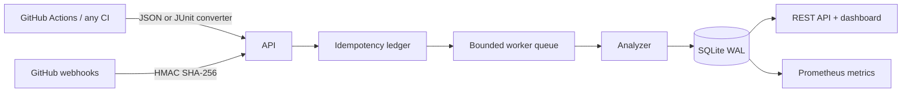

# TriageCI

[](https://github.com/EesherJ39/TriageCI/actions/workflows/ci.yml)

TriageCI reads your CI test history and tells you whether a failing test is flaky or actually broken.

It takes test reports from GitHub Actions or JUnit XML, queues them, and classifies every test from its pass/fail history. I built the ingestion API, report validation, duplicate protection, the worker queue, the analyzer, the dashboard and the JUnit converter. There is a longer write-up with a live demo of the classifier at [eesherj.com/projects/triageci](https://eesherj.com/projects/triageci).

## Why I built it

When a CI test fails, the code might be broken, the test might be flaky, or the CI machine might have had a bad day. Most teams press re-run until the build goes green, and that throws away the information you need to tell those cases apart.

TriageCI keeps every result. For each test it tracks the pass/fail mix, how often the result flips, the length of the current failure streak, and whether the test both passed and failed on the same commit. From that it labels the test stable, flaky, regression or consistently failing, and it shows you the counts behind the label. It also groups repeated failures by a normalized stack-trace signature, so the same timeout on different line numbers or temp paths shows up as one problem.

It never quarantines a test or changes a CI result on its own. What to do about a flaky test is up to the team.

## Run it

You need Node.js 24 or newer.

```bash
git clone https://github.com/EesherJ39/TriageCI.git
cd TriageCI
npm ci --ignore-scripts

export TRIAGECI_TOKEN='replace-me'
export GITHUB_WEBHOOK_SECRET='replace-me-too'
npm start
```

Open `http://localhost:8080`. To fill the dashboard with stable, flaky and regressed tests, run this in another terminal:

```bash
npm run demo:seed
```

## Send a report

```bash
curl -X POST http://localhost:8080/api/v1/runs \
  -H 'Content-Type: application/json' \
  -H 'X-TriageCI-Token: replace-me' \
  -H 'Idempotency-Key: github-run-123-attempt-1' \
  --data @report.json
```

The report format works with any CI system:

```json
{
  "repository": "owner/repository",
  "runId": "123",
  "attempt": 1,
  "commitSha": "abcdef1234567",
  "branch": "main",
  "tests": [
    {
      "suite": "checkout",
      "name": "charges card",
      "status": "failed",
      "durationMs": 912,
      "failure": "timeout while waiting for provider"
    }
  ]
}
```

If your test runner writes JUnit XML, the included converter turns it into that format. It only uses the Python standard library.

```bash
python scripts/junit_to_json.py test-results.xml \
  --repository "$GITHUB_REPOSITORY" \
  --run-id "$GITHUB_RUN_ID" \
  --attempt "$GITHUB_RUN_ATTEMPT" \
  --commit "$GITHUB_SHA" \
  --branch "$GITHUB_REF_NAME" \
  > triageci-report.json
```

The full HTTP interface is in [`openapi.yaml`](openapi.yaml).

## How it works



- **Checking who sent it.** GitHub webhooks are verified with HMAC-SHA256. Direct uploads need the API token, which is compared in constant time.
- **Safe retries.** CI systems retry uploads. Each report carries an idempotency key tied to a hash of its contents, so the same report sent twice is stored once, even across a restart. A different report reusing the same key gets a `409` and cannot overwrite history.
- **Pushing back when overloaded.** The API puts each report on a bounded queue and answers `202 Accepted`. When the queue is full it answers `429` and the CI job retries later. A separate delivery record shows when a report has actually been analyzed.
- **Storage.** SQLite in WAL mode, so the dashboard can read while the analyzer writes. Each report is analyzed in one transaction, and per-test statistics live in their own table so dashboard queries stay cheap.
- **Operations.** Health endpoints, Prometheus metrics and graceful shutdown.

The reasoning behind these choices is in [`docs/DESIGN.md`](docs/DESIGN.md), and the security boundary is in [`SECURITY.md`](SECURITY.md).

## How I tested it

```bash
npm test
npm run test:junit
npm run stress
docker build --tag triageci:local .
```

I ran the stress test three times against a fresh database. Each run sent 5,000 reports of 25 tests from 64 concurrent clients, with four workers processing them, for 125,000 test results per run. I planted five flaky tests and three regressions in the data.

- **375,000** test results processed across the three runs, with zero processing failures.
- **8 of 8** planted flaky tests and regressions found in every run.
- **300 of 300** replayed deliveries deduplicated (100 per run), and every invalid-token request rejected.
- **12,261 test results a second** median throughput (490 reports a second). That was on my desktop (Intel i7-13700K, 32 GB RAM, Windows 11, Node 24) over localhost, so it measures the code and says nothing about a production deployment.

The per-run numbers and latency percentiles are in [`docs/BENCHMARK.md`](docs/BENCHMARK.md). `npm run stress` writes the exact workload and latency distribution to `benchmark-results.json`.

## Limitations

The queue lives in memory. If the process crashes, reports that were accepted but not yet processed stay incomplete. The delivery ledger shows which ones, but nothing retries them automatically; that would need a durable message broker. It also runs on one machine only, and every write goes through SQLite's single writer, which caps how far it scales.

What I would most like to do next is run it with a real team for a few weeks and compare its labels with what the developers think, especially the false positives.

## Repo map

| Path | What it does |
|---|---|
| `src/analyzer.ts` | test-history statistics and the flaky/regression classifier |
| `src/database.ts` | schema, transactions, per-test statistics and the delivery ledger |
| `src/queue.ts` | bounded background processing and backpressure |
| `src/auth.ts` | webhook signatures and token checks |
| `src/dashboard.ts` | the live dashboard, no build step |
| `scripts/junit_to_json.py` | JUnit XML converter |
| `scripts/stress.mjs` | concurrent ingestion, replay, auth and latency workload |
| `openapi.yaml` | HTTP interface |
